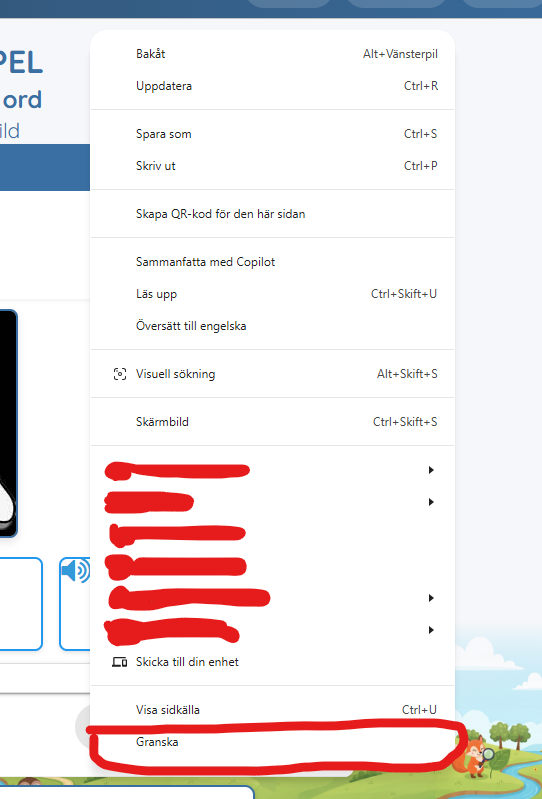

# Elevspel.se-cheats

A cheat you can just paste into the console and it pops a UI.

Here's how:

Step one:

Right click anywhere on the page and press "Inspect" or "Granska" (in swedish)

In the top bar (might not look identical to mine) press "Console"

Then copy the code from "showAnswers.js" and paste it into there, then press enter.

---

## Supported game modes

- Multiple choice
- Written answers
- 