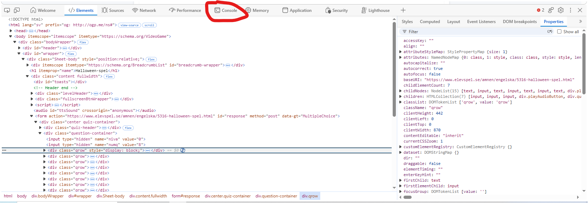
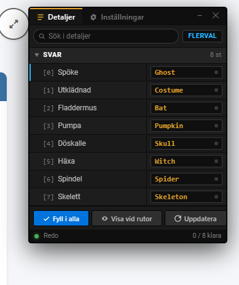

# Elevspel.se-cheats

A cheat you can just paste into the console and it pops a UI.

## Supported game modes

- Multiple choice
- Written answers
- Memory
- Letter board

## Running

1. Right click anywhere on the page and press "Inspect" or "Granska" (in swedish)

2. In the top bar (might not look identical to mine) press "Console"

3. Copy the code from "showAnswers.js" and paste it into there, then press enter.

---